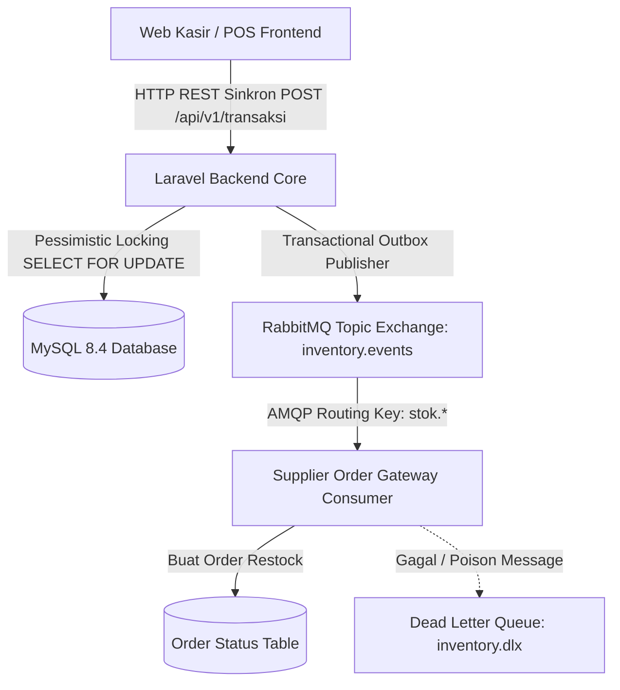

<div align="center">

# 🛒 Warung Kelontong Pak Hendy
### Sistem Manajemen Kasir Digital & Rantai Pasok Terdistribusi (*Supply Chain*)

[](https://laravel.com)
[](https://php.net)
[](https://mysql.com)
[](https://rabbitmq.com)
[](https://react.dev)
[](.)
[](./openapi.yaml)

**Mata Kuliah:** Integrasi Sistem dan Komputasi Awan (25IF1504)  
**Program Studi:** S1 Teknik Informatika — STMIK Bandung  
**Kelompok 67:**
* **Difki Junaedi** *(Infra, Docker Compose, Outbox Publisher)*
* **Nurul Hidayah** *(REST API, RFC 9457 Error Handling, Feature Testing)*
* **Bima Azmi Khoerullah** *(RabbitMQ Consumer, DLQ Handler, Idempotency)*

---

### 📚 PUSAT NAVIGASI DOKUMENTASI PROYEK
*Klik tombol di bawah ini untuk langsung menavigasi dokumen spesifik secara otomatis di GitHub:*

| 📋 Panduan Utama | 📮 Pengujian API | 🏗️ Arsitektur & Sistem | 🗄️ Database & Kontrak |
| :---: | :---: | :---: | :---: |
| [](./penjelasan.md) | [](./postman.md) | [](./architecture.md) | [](./schema.md) |
| [](./laporan-integrasi-warung-pak-hendy.pdf) | [](./api.md) | [](./flow.md) | [](./contracts.md) |
| [](./roadmap.md) | [](./docs/postman/xavyera-uts.postman_collection.json) | [](./broker.md) | [](./scenarios.md) |

</div>

---

## 📌 1. Gambaran Umum & Studi Kasus

Warung Kelontong Pak Hendy menghadapi masalah klasik operasional ritel berupa **Data Silo** (pemisahan pencatatan kasir, gudang fisik, dan pemesanan supplier via chat). Hal ini memicu risiko:
1. **Overselling:** Kasir menjual barang yang fisiknya telah kosong di gudang.
2. **Stockout:** Keterlambatan memesan ulang produk *fast-moving* (minyak goreng, beras, gula, mie instan).
3. **Rekonsiliasi Manual:** Selisih antara pencatatan keuangan dan saldo fisik barang.

Sistem ini memadukan dua gaya integrasi (*Enterprise Integration Patterns*):
* **Jalur Sinkron (REST API):** Konfirmasi instan transaksi POS kasir dengan penguncian basis data ACID (*Pessimistic Locking*).
* **Jalur Asinkron (RabbitMQ):** Pengiriman notifikasi pemesanan ulang secara longgar (*loose coupling*) ke supplier saat stok mencapai batas minimum.

---

## 🏗️ 2. Topologi Arsitektur Sistem



---

## 💻 3. Fitur Utama & Menu Web Aplikasi

Akses aplikasi di browser: **[http://localhost:8090](http://localhost:8090)**

1. **Dashboard & Katalog Produk:**
   * Menampilkan daftar barang, harga, dan sisa stok fisik secara *real-time*.
   * **Badge Status Stok:** Warna hijau (aman), kuning (mendekati ambang batas minimum), dan merah (habis).
2. **Pencarian Cepat & Sync Stok:** Pencarian instan berdasarkan SKU atau nama barang, dilengkapi tombol sinkronisasi API.
3. **Keranjang Kasir & POS Checkout:**
   * Menambah/mengurangi kuantitas belanja dengan validasi stok instan.
   * Tombol pembayaran untuk memanggil endpoint REST API `POST /api/v1/transaksi`.
4. **Modal Struk & Error RFC 9457:** Menampilkan struk transaksi sukses (`201 Created`) atau modal galat berstandar RFC 9457 (`409 Conflict`).
5. **cURL Demo Modal & Unduh PDF:** Kotak dialog berisi perintah cURL siap pakai untuk demo dosen serta tombol unduh naskah laporan 12 halaman (`laporan-integrasi-warung-pak-hendy.pdf`).

---

## 🔌 4. Ringkasan REST API & RFC 9457

Seluruh endpoint berada di bawah base URL `http://localhost:8090/api/v1`:

| Method | Endpoint | Deskripsi | Respons Sukses |
| :---: | :--- | :--- | :---: |
| **GET** | `/produk` | Mengambil seluruh katalog produk & stok | `200 OK` |
| **GET** | `/produk/{sku}` | Mengambil detail produk berdasarkan SKU | `200 OK` |
| **POST** | `/transaksi` | Memproses transaksi penjualan kasir (POS) | `201 Created` |
| **POST** | `/persediaan/reorder` | Membuat pemesanan ulang manual ke supplier | `201 Created` |
| **GET** | `/persediaan/reorder` | Melihat riwayat status pemesanan supplier | `200 OK` |

> **Format Galat (Error Handling):** Mengikuti standar **RFC 9457 Problem Details** dengan `Content-Type: application/problem+json` memuat properti `type`, `title`, `status`, `detail`, dan `instance`.

---

## 🚀 5. Panduan Menjalankan dari Nol

### Prasyarat
* Docker & Docker Compose (Laravel Sail)
* PHP >= 8.5 & Composer
* Node.js >= 20 & npm

### Langkah Instalasi
```bash
# 1. Kloning repositori & masuk direktori proyek
git clone https://github.com/asukarew/UTS.git
cd UTS

# 2. Salin environment & install dependency
cp .env.example .env
composer install
npm install
npm run build

# 3. Jalankan container Docker (App, MySQL 8.4, RabbitMQ 4.0)
./vendor/bin/sail up -d

# 4. Jalankan migrasi dan seeder database
./vendor/bin/sail artisan migrate:fresh --seed
```

---

## 🧪 6. Pengujian & Validasi Kontrak

### A. Otomasi Pengujian (Feature Tests)
```bash
./vendor/bin/sail artisan test
```
*Hasil:* **116 passed (484 assertions) — 100% Green.**

### B. Validasi Kontrak OpenAPI (Spectral Linter)
```bash
npx @stoplight/spectral-cli lint openapi.yaml
```
*Hasil:* **0 errors, 0 warnings.**

---

## ⏱️ 7. Skenario Demonstrasi 4 Menit di Depan Dosen

1. **Menit 0–1:** Jelaskan masalah *Data Silo* warung tradisional dan arsitektur *dual-channel* (REST sinkron untuk POS, RabbitMQ asinkron untuk supplier).
2. **Menit 1–2.5:** Demonstrasikan pemanggilan cURL transaksi sukses (`201`) dan transaksi gagal stok kurang (`409 Conflict` berformat RFC 9457).
3. **Menit 2.5–3.5:** Tunjukkan hasil *Feature Tests* (`php artisan test` 116 lulus) dan buka RabbitMQ Dashboard di `http://localhost:15672` (`guest`/`guest`).
4. **Menit 3.5–4:** Sesi tanya jawab bersama anggota kelompok (Difki, Nurul, Bima).
